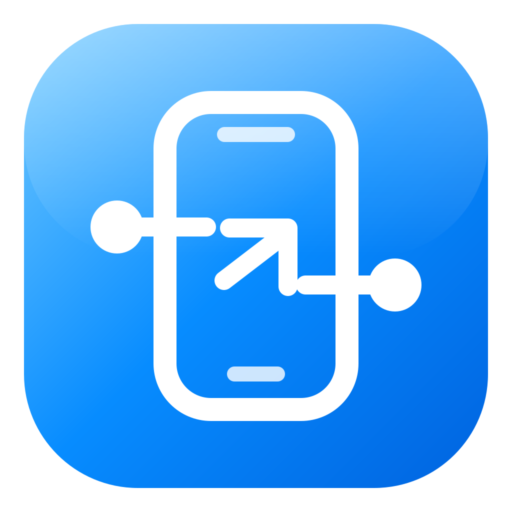

<p align="center">
  <a href="https://github.com/jkaae93/adb-connector">
    <picture>
      <source srcset="assets/app_icon.svg">
      
    </picture>
  </a>
</p>

<h1 align="center">ADB Connector</h1>

<p align="center">
  Mac에서 Android / iOS 기기를 무선으로 연결하고 관리하세요.<br>
  <code>adb connect</code>, logcat, 파일 전송 — 터미널 없이 버튼으로.
</p>

<p align="center">
  <a href="./README.md">English</a> · <a href="https://github.com/jkaae93/adb-connector/releases/latest">다운로드</a>
</p>

<p align="center">
  <a href="https://github.com/jkaae93/adb-connector/releases/latest"></a>
  
  
  <a href="#라이선스"></a>
</p>

<details>
<summary><strong>무선 우선 기기 대시보드.</strong></summary>

[](https://github.com/jkaae93/adb-connector/stargazers)
[](https://github.com/jkaae93/adb-connector/commits)
[](https://github.com/jkaae93/adb-connector/issues)

</details>
<p></p>
우리의 철학:

```text
→ 입력이 아닌 클릭
→ 유선이 아닌 무선
→ 터미널 다섯 개가 아닌 하나의 창
→ 무분별한 스크립트가 아닌 승인된 자동화
```

<p align="center">
  ⭐ 저장소에 Star를 눌러 소식을 받아보세요 · 새 버전은 <a href="https://github.com/jkaae93/adb-connector/releases">릴리스</a>에서 확인하세요.
</p>

<!-- TODO: USB 연결 → 무선 전환 → logcat 흐름의 GIF 데모 추가 -->

## 사용 예시

```text
사용자: Android 폰을 USB로 연결
앱: Pixel 8 감지 · 192.168.0.12 · 시리얼 저장 ✓

사용자: "무선 전환" 클릭
앱: adb tcpip 5555 → WiFi로 재연결 ✓ (케이블 뽑기)

사용자: 다음 날 아침 "연결" 클릭
앱: adb connect 192.168.0.12:5555 ✓ (실패 시 시리얼 기반 자동 재시도)

사용자: 로그 / 파일 버튼 클릭
앱: 실시간 logcat 스트림 · 드래그&드롭으로 파일 전송 ✓

AI 에이전트: GET /devices (로컬 MCP 서버, 토큰 인증)
앱: 승인 팝업 → 사용자가 승인 → 결과 반환 ✓
```

<details>
<summary><strong>AI 에이전트 설정은 실제로 어떻게 생겼나요?</strong></summary>

설정에서 로컬 MCP 서버를 켜고, HTTP 또는 stdio 설정을 복사해 MCP 클라이언트에 등록한 뒤, 민감한 작업마다 앱에서 승인하면 됩니다:

```json
{
  "mcpServers": {
    "adb-connector": {
      "url": "http://127.0.0.1:PORT/mcp",
      "headers": { "Authorization": "Bearer <매번-바뀌는-토큰>" }
    }
  }
}
```

조회(기기, ADB 버전, mDNS, 최근 로그, 파일 목록)는 바로 제공하고, 변경 작업(연결, 페어링, APK 설치, 파일 전송, 포트 규칙)은 앱에서 승인한 뒤에만 실행됩니다. 토큰은 서버를 다시 켤 때마다 변경됩니다.

</details>

## 왜 ADB Connector인가요?

혼자 쓸 때는 터미널 반복 작업(`adb tcpip`, IP 재확인, logcat 필터링)을 기기를 기억하는 하나의 창으로 바꿔줍니다. 팀에서는 한 걸음 더 나아갑니다. 로컬 MCP 서버로 인증된 AI 에이전트가 기기와 로그를 조회하고, 모든 변경 작업은 사용자의 명시적 승인을 기다립니다.

- **무선 우선** — 한 번만 유선으로 등록하면 같은 네트워크 어디서든 클릭 한 번으로 WiFi 연결.
- **올인원 툴박스** — 페어링(코드, mDNS, QR), APK 설치, 포트 포워드/리버스, 파일 브라우저, logcat 프리셋을 한곳에.
- **안전한 AI 연동** — 요청별 승인, 회전 토큰, 페어링 코드 미기록으로 MCP 접근을 보호.

> macOS(Apple Silicon / Intel)가 필요합니다. Android는 **USB 디버깅**을 켜고, 무선 사용 시 기기와 Mac이 같은 WiFi에 있어야 합니다.

## 빠른 시작

앱을 다운로드한 뒤:

```bash
# 1. 다운로드 후 /Applications으로 이동
open https://github.com/jkaae93/adb-connector/releases/latest
```

1. `ADB Connector.app`을 `/Applications` 폴더로 드래그합니다.
2. 첫 실행: 서명되지 않은 앱이라 macOS가 차단할 수 있습니다. **우클릭(Control+클릭) → 열기 → 열기**(최초 1회) 또는 `xattr -cr "/Applications/ADB Connector.app"` 실행. macOS Sequoia 이상에서 우클릭 열기가 안 되면 **시스템 설정 → 개인정보 보호 및 보안 → "그래도 열기"**를 사용하세요.
3. 상단에 ADB 설치 배너가 보이면 **설치**를 누르세요. Google 공식 platform-tools를 자동으로 내려받아 설치합니다. 이미 설치된 ADB(Android Studio, Homebrew)는 자동으로 감지해 사용합니다.
4. Android 폰을 USB로 연결하고 **USB 디버깅 허용**을 승인하면 앱이 기기를 감지·저장합니다. **무선 전환**을 누르고 케이블을 뽑으면 무선 상태가 유지됩니다.

> **한 줄 요약**: `brew install libimobiledevice`로 iPhone/iPad 감지와 syslog 지원을 추가할 수 있습니다(앱 내 설치 버튼도 제공).

## 문서

자세한 내용은 모두 이 README에 있습니다:

→ **[주요 기능](#주요-기능)**: 앱이 할 수 있는 일<br>
→ **[사용 방법](#사용-방법)**: 일상 워크플로 단계별 안내<br>
→ **[AI 에이전트(MCP)](#ai-에이전트-mcp-서버)**: Claude / Codex / 커스텀 에이전트 연결<br>
→ **[업데이트](#업데이트)**: Sparkle 자동 업데이트와 수동 설치<br>
→ **[소스에서 직접 빌드](#소스에서-직접-빌드)**: Flutter 3.41 이상<br>
→ **[데이터와 개인정보](#데이터와-개인정보)**: 파일 저장 위치<br>
→ **[문제 해결](#문제-해결)**: 자주 발생하는 문제와 해결법

## 주요 기능

**연결**

- **원클릭 무선 ADB** — 저장된 기기를 `adb connect`로 재연결, 실패 시 시리얼 기반 `tcpip` 재초기화 후 자동 재시도
- **USB → 무선 전환** — 클릭 한 번으로 `adb tcpip` 실행 후 무선 재연결, 이후 케이블 제거 가능
- **기기 자동 감지·저장** — USB로 꽂기만 하면 IP·시리얼·모델명을 감지해 저장
- **연결 상태 실시간 표시** — 5초마다 자동 갱신, USB/WiFi 뱃지 표시
- **무선 디버깅 페어링** — 페어링 코드 및 mDNS 검색, 지원하는 Canary ADB의 QR 페어링
- **빠른 연결** — 저장 없이 IP만 입력해 일회성 연결

**개발**

- **Logcat 뷰어** — 앱 내 실시간 스트리밍과 버퍼 클리어, 또는 Terminal·iTerm2·Warp·Alacritty·kitty·Ghostty·Hyper 중 선택해 외부 실행(전체 / Flutter 전용 / 커스텀 필터 프리셋)
- **파일 브라우저** — 기기 파일 시스템 탐색, 드래그&드롭 업로드, 다운로드(`adb push`/`pull`)
- **개발 도구** — APK/split APK 설치, TCP 포워드·리버스 규칙 관리, 파일 전송 옵션
- **iPhone/iPad 지원** — libimobiledevice 기반 기기 감지 및 syslog 확인
- **라이트·다크 모드** — 시스템 설정을 따르거나 설정에서 직접 선택

**자동화와 업데이트**

- **로컬 MCP 서버** — 인증된 AI 에이전트에서 기기·로그 조회, 연결·해제 등 변경 작업은 요청별 사용자 승인 후 실행
- **GitHub 릴리스 확인** — 설정에서 최신 릴리스 확인과 macOS ZIP 다운로드, 서명된 릴리스 자동 설치
- **ADB 자동 설치** — ADB가 없으면 Google 공식 platform-tools를 자동 다운로드·설치

## 사용 방법

### 화면과 ADB 설정

설정에서 시스템·라이트·다크 테마를 고를 수 있습니다. ADB 실행 파일 경로와 버전을 확인하거나 다른 ADB 실행 파일을 선택할 수 있습니다. 코드 페어링은 Android의 무선 디버깅 화면에 표시된 **페어링 포트**와 코드를 입력합니다. 페어링이 끝나면 검색된 연결 서비스를 선택하거나 기기의 연결 포트로 빠른 연결을 사용하세요. QR 페어링은 `pair --qr`을 지원하는 ADB가 필요합니다.

### 1. 기기 최초 등록 (USB)

1. Android 기기를 USB로 Mac에 연결합니다.
2. 기기 화면에서 **USB 디버깅 허용** 팝업을 승인합니다.
3. 앱이 기기 정보(IP, 시리얼, 모델명)를 자동으로 감지하고 목록에 저장합니다.

### 2. USB → 무선 전환

USB로 연결된 기기 항목의 **무선 전환** 버튼을 누르면 `adb tcpip` 실행 후 무선으로 재연결됩니다. 이후 USB 케이블을 뽑아도 연결이 유지됩니다.

### 3. 무선 연결 / 해제

- 저장된 기기의 **연결** 버튼: `adb connect {ip}:{port}` 실행. 실패하면 시리얼 기반으로 `adb tcpip` 재초기화 후 자동 재시도합니다.
- **연결 해제** 버튼: `adb disconnect` 실행.

### 4. Logcat 보기

기기 항목의 로그 버튼으로 실행합니다.

- **앱 내 뷰어**: 실시간 로그 스트리밍, 버퍼 클리어 지원.
- **터미널에서 열기**: 설치된 앱 중 선택(Terminal, iTerm2, Warp, Alacritty, kitty, Ghostty, Hyper):
  - **전체**: 필터 없이 전체 로그.
  - **Flutter**: `flutter` 태그만 필터링.
  - **커스텀**: 출력 포맷, 태그, 버퍼, 정규식 필터, 최대 줄 수 지정.
- iOS 기기는 logcat 대신 **syslog**(idevicesyslog)를 표시합니다.

### 5. 파일 브라우저

연결된 기기의 파일 버튼으로 실행합니다.

- 폴더를 클릭해 기기 파일 시스템 탐색.
- **업로드**: Mac의 파일을 창으로 드래그&드롭.
- **다운로드**: 파일 옆 다운로드 버튼 → 저장할 폴더 선택.

### 6. 기기 관리

- **수정**: 연필 아이콘으로 별명, IP, 포트, 시리얼 편집.
- **삭제**: 휴지통 아이콘으로 저장 목록에서 제거.
- **수동 추가**: 상단 `+` 버튼으로 IP를 직접 입력해 추가.

### 7. 빠른 연결

하단 "빠른 연결" 섹션에 IP와 포트(기본 5555)를 입력하고 **연결**을 누르면 저장 없이 일회성으로 연결합니다.

### 8. iPhone/iPad (선택)

```bash
brew install libimobiledevice
```

또는 앱 상단의 iOS 지원 안내에서 **설치**를 누르면 Homebrew 설치 로그와 결과를 앱에서 확인할 수 있습니다. 설치가 완료되면 기기를 다시 감지합니다. Homebrew가 없거나 관리자 인증이 필요하면 복사 버튼으로 명령을 복사해 터미널에서 실행하세요. 설치 후 USB/WiFi로 연결된 iOS 기기를 자동 감지하며, 기기 이름·모델 표시와 syslog 확인을 지원합니다.

### AI 에이전트 (MCP 서버)

설정의 로컬 MCP 서버를 켜고 HTTP 또는 stdio 연결 설정을 복사해 MCP 클라이언트에 등록하세요. stdio 연결에는 Python 3과 실행 중인 앱이 필요합니다. 서버 주소와 토큰은 서버를 다시 켤 때마다 변경되므로 설정을 다시 복사해야 합니다. 기기·ADB 버전·mDNS·최근 로그·파일 목록을 조회할 수 있으며, 연결·페어링·재연결, ADB 서버·전송 모드 변경, APK 설치, 파일 전송과 포트 규칙 변경은 앱에서 개별 승인 후 실행됩니다. 설정의 요청 내역은 앱 실행 중에만 보관하며 페어링 코드는 기록하지 않습니다. 연결 설정에는 비밀 토큰이 포함되므로 공유하지 마세요.

## 업데이트

앱은 하루에 한 번 GitHub의 새 정식 릴리스를 확인합니다. 설정에서 수동으로 확인하고 macOS ZIP을 다운로드할 수도 있습니다. 릴리스에 서명된 `appcast.xml`이 있으면 Sparkle을 통해 다운로드·서명 검증·교체·재실행할 수 있습니다. 이전 릴리스처럼 appcast가 없으면 ZIP을 열어 앱을 직접 교체합니다. GitHub가 SHA-256 체크섬을 제공하면 수동 다운로드도 검증합니다. v1.0.1 이전 앱에는 업데이트 기능이 없으므로 첫 설치는 직접 해야 합니다.

<details>
<summary><strong>서명된 릴리스 준비 (메인테이너)</strong></summary>

자동 업데이트 공개키는 앱에 포함되어 있으며, 개인키는 이 Mac의 로그인 키체인에서 `adb-connector-release` 계정으로 관리합니다. 키를 안전한 위치에 백업하고 GitHub Actions 저장소 secret `SPARKLE_PRIVATE_KEY`에 등록해야 합니다. 개인키는 저장소나 로그에 커밋하지 마세요.

1. `flutter pub get && flutter build macos --config-only`로 Sparkle 도구를 준비합니다.
2. `macos/Pods/Sparkle/bin/generate_keys --account adb-connector-release -x /안전한/경로/개인키`로 키를 내보내 안전하게 백업합니다. 내보낸 파일을 `gh secret set SPARKLE_PRIVATE_KEY < /안전한/경로/개인키`로 등록한 뒤, 불필요한 평문 사본은 안전하게 제거합니다.
3. `pubspec.yaml` 버전과 빌드 번호를 올리고 GitHub Actions의 **Prepare signed macOS release**를 `v버전` 태그로 실행합니다. 워크플로는 개인키가 앱의 공개키와 일치하는지 확인하고 `signed-macos-release` 아티팩트를 만듭니다.
4. 생성된 ZIP과 `appcast.xml`을 같은 태그의 정식 GitHub 릴리스에 첨부합니다. 워크플로는 릴리스를 자동 게시하지 않습니다.

빌드 번호는 릴리스마다 증가해야 합니다. 개인키를 분실하면 기존 설치본에 서명된 업데이트를 제공할 수 없으므로 백업이 필요합니다.

</details>

## 소스에서 직접 빌드

Flutter 3.41 / Dart 3.11 이상이 필요합니다.

```bash
# 의존성 설치
flutter pub get

# 디버그 실행
flutter run -d macos

# 릴리즈 빌드
flutter build macos --release
# 결과물: build/macos/Build/Products/Release/ADB Connector.app
```

빌드된 `.app`을 zip으로 압축하면 그대로 배포할 수 있습니다.

```bash
cd build/macos/Build/Products/Release
ditto -c -k --keepParent "ADB Connector.app" "ADB-Connector.zip"
```

## 데이터와 개인정보

| 항목 | 경로 |
|---|---|
| 저장된 기기 목록 | `~/Library/Application Support/adb_connector/saved_devices.json` |
| 자동 설치된 ADB | `~/Library/Application Support/adb_connector/platform-tools/` |
| 터미널 앱 선택 설정 | `~/Library/Application Support/adb_connector/terminal_prefs.json` |

모든 데이터는 Mac 안에만 보관됩니다. 계정도, 텔레메트리도 없습니다. MCP 요청 내역은 앱 실행 중에만 메모리에 보관되며, 페어링 코드는 기록하지 않습니다.

## 문제 해결

**앱이 "손상되었기 때문에 열 수 없습니다"라고 나올 때**

- 서명되지 않은 앱이라 발생하는 정상적인 경고입니다. 위 [빠른 시작](#빠른-시작)의 `xattr -cr` 명령을 실행하세요.

**무선 연결이 실패할 때**

- 기기와 Mac이 같은 WiFi 네트워크에 있는지 확인.
- 기기의 개발자 옵션에서 **무선 디버깅**이 켜져 있는지 확인.
- USB로 다시 연결하면 앱이 IP를 재감지합니다.

**ADB가 감지되지 않을 때**

- 상단 배너의 **설치** 버튼으로 자동 설치.
- 또는 `brew install --cask android-platform-tools`로 직접 설치.

**iOS 기기가 보이지 않을 때**

- `brew install libimobiledevice` 설치 여부 확인.
- 기기에서 "이 컴퓨터를 신뢰하시겠습니까?" 팝업 승인.

## 기술 정보

- Flutter Material 3 기반 macOS 데스크톱 앱
- ADB/libimobiledevice 호출: `dart:io` `Process`
- 파일 드래그&드롭: `desktop_drop`, 저장 위치 선택: `file_picker`
- ADB 실행(subprocess)을 위해 macOS 앱 샌드박스 비활성화 (`macos/Runner/*.entitlements`)

## 기여하기

이슈와 PR은 언제든 환영합니다. 문제를 보고할 때는 기기, macOS 버전, ADB 버전을 함께 적어주세요.

```bash
flutter test
```

## 기타

<details>
<summary><strong>그냥 터미널을 쓰면 안 되나요?</strong></summary>

물론 됩니다. 모든 버튼은 평범한 `adb` 명령어에 대응합니다. ADB Connector는 반복되는 부분 — IP 기억하기, 재부팅 후 `tcpip` 다시 실행, 필터를 맞춰 logcat 보기, `push`/`pull` 경로 다시 입력 — 을 없애줄 뿐입니다. 나머지는 터미널을 계속 쓰셔도 됩니다.

</details>

## 라이선스

Personal utility. Free to use and modify.
