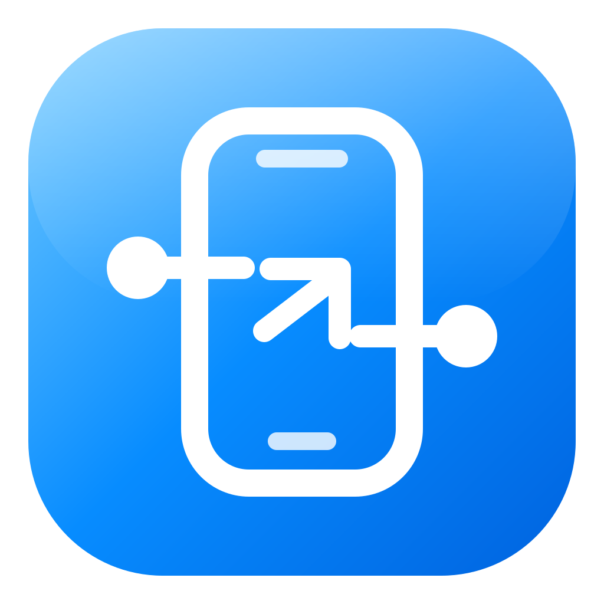

<p align="center">
  <a href="https://github.com/jkaae93/adb_connector">
    <picture>
      <source srcset="assets/app_icon.svg">
      
    </picture>
  </a>
</p>

<h1 align="center">ADB Connector</h1>

<p align="center">
  Connect and manage Android / iOS devices wirelessly from your Mac.<br>
  <code>adb connect</code>, logcat, and file transfer — no terminal required.
</p>

<p align="center">
  <a href="./README.ko.md">한국어</a> · <a href="https://github.com/jkaae93/adb_connector/releases/latest">Download</a>
</p>

<p align="center">
  <a href="https://github.com/jkaae93/adb_connector/releases/latest"></a>
  
  
  <a href="#license"></a>
</p>

<details>
<summary><strong>Your wireless device dashboard.</strong></summary>

[](https://github.com/jkaae93/adb_connector/stargazers)
[](https://github.com/jkaae93/adb_connector/commits)
[](https://github.com/jkaae93/adb_connector/issues)

</details>
<p></p>
Our philosophy:

```text
→ click not type
→ wireless not tethered
→ one window not five terminals
→ approved automation not blind scripts
```

<p align="center">
  ⭐ Star the repo for updates · Watch <a href="https://github.com/jkaae93/adb_connector/releases">Releases</a> for new versions.
</p>

<!-- TODO: Add GIF demo of USB plug-in → wireless switch → logcat workflow -->

## See it in action

```text
You: plug in Android phone via USB
App: detected Pixel 8 · 192.168.0.12 · serial saved ✓

You: click "Switch to wireless"
App: adb tcpip 5555 → reconnected over WiFi ✓ (unplug the cable)

You: click "Connect" next morning
App: adb connect 192.168.0.12:5555 ✓ (auto-retries over serial)

You: click log / file buttons
App: live logcat stream · drag & drop files to device ✓

AI agent: GET /devices (local MCP server, token auth)
App: approval prompt → you approve → result returned ✓
```

<details>
<summary><strong>What does the AI-agent setup actually look like?</strong></summary>

Turn on the local MCP server in Settings, copy the HTTP or stdio snippet into your MCP client, and approve each sensitive action in the app:

```json
{
  "mcpServers": {
    "adb-connector": {
      "url": "http://127.0.0.1:PORT/mcp",
      "headers": { "Authorization": "Bearer <rotating-token>" }
    }
  }
}
```

Reads (devices, ADB version, mDNS, recent logs, file lists) are served directly; writes (connect, pair, install APK, push/pull, port rules) run only after you approve them in the app. Tokens rotate every time the server restarts.

</details>

## Why developers use ADB Connector

Solo, ADB Connector replaces the terminal dance — `adb tcpip`, re-detecting IPs, tailing logcat — with one window that remembers your devices. On a team, it goes further: a local MCP server lets authenticated AI agents inspect devices and logs, while every mutating action waits for your explicit approval.

- **Wireless-first** — plug in once, then connect over WiFi with one click from anywhere on the same network.
- **Full toolbox** — pairing (code, mDNS, QR), APK install, port forward/reverse, file browser, and logcat presets in one place.
- **AI-ready, safely** — MCP access with per-request approval, rotating tokens, and no pairing-code logging.

> Requires macOS (Apple Silicon / Intel). Android needs **USB debugging** on; wireless use needs the device and Mac on the same WiFi.

## Quick Start

Download the app, then:

```bash
# 1. Download and move to /Applications
open https://github.com/jkaae93/adb_connector/releases/latest
```

1. Drag `ADB Connector.app` into `/Applications`.
2. First launch: the app is unsigned, so macOS may block it. **Right-click (Control+click) → Open → Open** (once), or run `xattr -cr "/Applications/ADB Connector.app"`. On macOS Sequoia and later, if right-click Open fails, use **System Settings → Privacy & Security → "Open Anyway"**.
3. If you see the ADB banner, click **Install** — the official Google platform-tools are downloaded automatically. An existing ADB (Android Studio, Homebrew) is detected and used as-is.
4. Plug in your Android phone via USB, accept **Allow USB debugging**, and the app detects and saves it. Hit **Switch to wireless**, unplug, and you're cable-free.

> **Want the one-liner?** `brew install libimobiledevice` adds iPhone/iPad detection and syslog support (or use the in-app Install button).

## Docs

Everything below lives in this README:

→ **[Features](#features)**: what the app can do<br>
→ **[Usage](#usage)**: daily workflows, step by step<br>
→ **[AI agents (MCP)](#ai-agents-mcp-server)**: connect Claude / Codex / custom agents<br>
→ **[Updating](#updating-adb-connector)**: Sparkle auto-updates and manual installs<br>
→ **[Build from source](#build-from-source)**: Flutter 3.41+<br>
→ **[Data & privacy](#data--privacy)**: where files live<br>
→ **[Troubleshooting](#troubleshooting)**: fixes for common issues

## Features

**Connect**

- **One-click wireless ADB** — saved devices reconnect with `adb connect`, with serial-based `tcpip` re-init + retry on failure
- **USB → wireless switch** — one click runs `adb tcpip` and reconnects, then unplug the cable
- **Auto-detect & save** — plug in via USB and IP, serial, and model are detected and stored
- **Live status** — auto-refresh every 5 seconds with USB/WiFi badges
- **Wireless debugging pairing** — pairing code + mDNS discovery, plus QR pairing on ADB builds that support it
- **Quick connect** — one-off connection from an IP with no saving

**Develop**

- **Logcat viewer** — in-app live stream with buffer clear; or open in Terminal, iTerm2, Warp, Alacritty, kitty, Ghostty, Hyper (full / Flutter-only / custom filter presets)
- **File browser** — explore the device filesystem, drag & drop uploads, downloads (`adb push`/`pull`)
- **Dev tools** — APK/split-APK install, TCP forward/reverse rule management, transfer options
- **iPhone/iPad support** — device detection + syslog via libimobiledevice
- **Light & dark mode** — follows the system or set explicitly in Settings

**Automate & update**

- **Local MCP server** — token-authenticated device/log queries for AI agents; connect/disconnect and other writes need your per-request approval
- **GitHub release checks** — check for releases in Settings, download the macOS ZIP, auto-install signed releases
- **ADB auto-install** — missing ADB? Official platform-tools are downloaded and installed for you

## Usage

### Appearance & ADB settings

Settings offers system / light / dark themes, shows the ADB binary path and version, and lets you pick a different ADB. Code pairing uses the **pairing port** and code shown on Android's Wireless debugging screen; after pairing, pick a discovered connection service or use Quick connect with the device's connection port. QR pairing needs an ADB with `pair --qr` support.

### 1. First-time registration (USB)

1. Connect the Android device to your Mac via USB.
2. Approve the **Allow USB debugging** popup on the device.
3. The app auto-detects the device info (IP, serial, model) and saves it to the list.

### 2. USB → wireless switch

Press **Switch to wireless** on a USB-connected device: the app runs `adb tcpip`, then reconnects wirelessly. The connection survives after unplugging the cable.

### 3. Wireless connect / disconnect

- **Connect** on a saved device runs `adb connect {ip}:{port}`; on failure it re-initializes via serial-based `adb tcpip` and retries automatically.
- **Disconnect** runs `adb disconnect`.

### 4. View logcat

Use the log button on a device entry.

- **In-app viewer** — real-time streaming + clear buffer.
- **Open in terminal** — pick from installed apps (Terminal, iTerm2, Warp, Alacritty, kitty, Ghostty, Hyper):
  - **Full**: unfiltered log.
  - **Flutter**: `flutter` tags only.
  - **Custom**: output format, tags, buffers, regex filters, max lines.
- iOS devices show **syslog** (idevicesyslog) instead of logcat.

### 5. File browser

Use the file button on a connected device.

- Click folders to explore the device filesystem.
- **Upload**: drag & drop Mac files into the window.
- **Download**: download button next to a file → choose a destination folder.

### 6. Manage devices

- **Edit**: pencil icon — nickname, IP, port, serial.
- **Delete**: trash icon — remove from the saved list.
- **Add manually**: top `+` button — enter an IP directly.

### 7. Quick connect

Enter IP + port (default 5555) in the bottom "Quick connect" section and press **Connect** for a one-off connection without saving.

### 8. iPhone/iPad (optional)

```bash
brew install libimobiledevice
```

Or press **Install** in the app's iOS-support banner to watch the Homebrew log and result in-app; devices are re-scanned when it finishes. If Homebrew is missing or admin auth is needed, use the copy button and run the command in a terminal. Afterwards, USB/WiFi iOS devices are auto-detected with name/model display and syslog support.

### AI agents (MCP server)

Turn on the local MCP server in Settings and copy the HTTP or stdio snippet into your MCP client. stdio needs Python 3 and the running app. The address and token change every time the server restarts, so re-copy the snippet. Query devices, ADB version, mDNS, recent logs, and file lists; connect/pair/reconnect, ADB-server/transfer-mode changes, APK installs, file transfers, and port-rule changes each run only after individual in-app approval. The request history in Settings lives only while the app runs, pairing codes are never recorded, and the snippet contains a secret token — don't share it.

## Updating ADB Connector

The app checks GitHub for new stable releases once a day. You can also check manually in Settings and download the macOS ZIP. If the release ships a signed `appcast.xml`, Sparkle downloads, verifies, replaces, and relaunches; releases without an appcast (like older ones) are updated by opening the ZIP and replacing the app yourself. Manual downloads are verified when GitHub provides a SHA-256 checksum. Apps before v1.0.1 have no updater, so the first install is always manual.

<details>
<summary><strong>Preparing a signed release (maintainer)</strong></summary>

The auto-update public key is bundled in the app; the private key lives in this Mac's login keychain under the account `adb-connector-release`. Back the key up somewhere safe and register it as the repo secret `SPARKLE_PRIVATE_KEY`. Never commit the private key or paste it into logs.

1. Prepare the Sparkle tools: `flutter pub get && flutter build macos --config-only`.
2. Export the key to a safe path: `macos/Pods/Sparkle/bin/generate_keys --account adb-connector-release -x /safe/path/private-key`. Register it with `gh secret set SPARKLE_PRIVATE_KEY < /safe/path/private-key`, then securely delete any unneeded plaintext copies.
3. Bump the version + build number in `pubspec.yaml` and run the GitHub Actions **Prepare signed macOS release** workflow on a `vX.Y.Z` tag. It verifies the private key matches the app's public key and produces the `signed-macos-release` artifact.
4. Attach the resulting ZIP and `appcast.xml` to the same tag's official GitHub release. The workflow never publishes a release by itself.

The build number must increase with every release. Lose the private key and existing installs can no longer receive signed updates — keep the backup.

</details>

## Build from source

Flutter 3.41 / Dart 3.11 or later required.

```bash
# Install dependencies
flutter pub get

# Debug run
flutter run -d macos

# Release build
flutter build macos --release
# Output: build/macos/Build/Products/Release/ADB Connector.app
```

Zip the `.app` to distribute it:

```bash
cd build/macos/Build/Products/Release
ditto -c -k --keepParent "ADB Connector.app" "ADB-Connector.zip"
```

## Data & privacy

| Item | Path |
|---|---|
| Saved device list | `~/Library/Application Support/adb_connector/saved_devices.json` |
| Auto-installed ADB | `~/Library/Application Support/adb_connector/platform-tools/` |
| Terminal app prefs | `~/Library/Application Support/adb_connector/terminal_prefs.json` |

Everything stays on your Mac: no accounts, no telemetry. MCP request history is kept in memory only while the app runs, and pairing codes are never written to it.

## Troubleshooting

**"The app is damaged and can't be opened"**

- Expected for an unsigned app. Run the `xattr -cr` command from [Quick Start](#quick-start).

**Wireless connection fails**

- Check the device and Mac are on the same WiFi network.
- Check **Wireless debugging** is on in the device's developer options.
- Re-plug via USB and the app re-detects the IP.

**ADB is not detected**

- Use the in-app banner's **Install** button for auto-install.
- Or install manually: `brew install --cask android-platform-tools`.

**iOS device doesn't show up**

- Check `brew install libimobiledevice` completed.
- Approve the **Trust This Computer?** popup on the device.

## Tech stack

- Flutter Material 3 macOS desktop app
- ADB / libimobiledevice via `dart:io` `Process`
- Drag & drop: `desktop_drop`, save picker: `file_picker`
- macOS app sandbox disabled (`macos/Runner/*.entitlements`) so ADB subprocesses can run

## Contributing

Issues and PRs are welcome — a failing case starts with what device, macOS version, and ADB version you used.

```bash
flutter test
```

## Other

<details>
<summary><strong>Why not just use the terminal?</strong></summary>

You can — every button maps to a plain `adb` command. ADB Connector just removes the repetitive parts: remembering IPs, re-running `tcpip` after reboot, tailing logcat with the right filters, and retyping `push`/`pull` paths. The terminal stays available for everything else.

</details>

## License

Personal utility. Free to use and modify.
